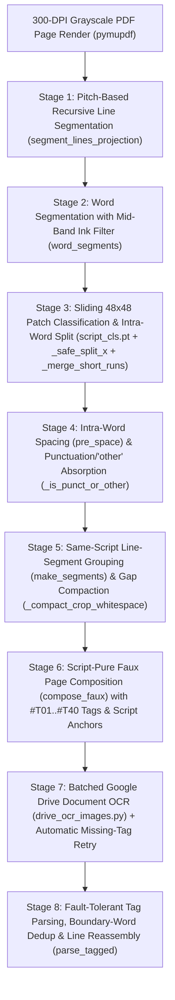

# Current Manipravalam OCR Pipeline

This document describes the active production pipeline for mixed Sanskrit (Devanāgarī) and Tamil (Maṇipravāḷa) OCR implemented in [`training/scripts/script_cls/pipeline.py`](../training/scripts/script_cls/pipeline.py) and [`training/scripts/apply_ocr_pdf.py`](../training/scripts/apply_ocr_pdf.py).

## Overview & Dataflow



### Models Used in the Active Pipeline
- **[Patch Script Classifier (`script_cls.pt`)](models/patch-script-classifier.md):** 48×48 residual CNN (`dev` / `tam` / `other` / `null`), retrained on 69,366 real word-image-map crops (**0.9921** validation accuracy).
- **[Google Drive Document OCR (`drive_ocr_images.py`)](models/google-drive-ocr.md):** Cloud line/document OCR engine invoked on script-pure phrase-strip faux pages (`--faux-batch 10`).

All retired/experimental models (`script_sep.pt`, `word_cls.pt`, boundary CNNs, `column_sep.pt`, `line_cls`, Kraken word OCR, `devTamCharsOCR`, and Tesseract/PaddleOCR baselines) are documented under [`models/obsolete/`](models/obsolete/).

---

## Stage-by-Stage Technical Specification

### Stage 1: Page Rendering & Pitch-Based Recursive Line Segmentation
- **Implementation:** [`apply_ocr_pdf.py::segment_lines_projection`](../training/scripts/apply_ocr_pdf.py#L64-L128) (called via `segment_lines`).
- **Input:** 300-DPI grayscale page array `arr` (`H × W`, `uint8`).
- **Algorithm:**
  1. Binarizes ink across the central 92% horizontal span (`x = 4% .. 96%`) using an adaptive threshold (`min(200, percentile(a, 25) + 15)`).
  2. Computes horizontal row-ink density `row_ink` and suppresses full-width horizontal separator rules (`row_ink > 0.55 * span_w`).
  3. Identifies initial line bands where smoothed `row_ink >= 0.006 * span_w`, merging micro-gaps `<= 3` px (`pad = 3` px).
  4. Computes the page's median single-line height `unit_h` and median center-to-center line pitch `pitch`.
  5. **Recursive multi-line splitting:** Any band taller than `max(unit_h + 0.55 * pitch, 1.55 * unit_h)` (caused by Tamil descenders like `ழ`, `ஞ`, `ளு` touching Devanāgarī upper mātrās on the next line) is split into `n_rem = max(2, round(((y1 - cur) - unit_h) / pitch) + 1)` lines by locating the minimum-ink projection valley near `cur + (y1 - cur) / n_rem` with non-overlapping padding.

### Stage 2: Word Segmentation with Middle-Band Ink Filtering
- **Implementation:** [`pipeline.py::word_segments`](../training/scripts/script_cls/pipeline.py#L72-L109).
- **Input:** Binarized `dark` (`arr < 128`) and line box `(lx0, ly0, lx1, ly1)`.
- **Algorithm:**
  1. Sums vertical column ink and splits at blank valleys of width `>= min_gap` (`4` px at 300 DPI).
  2. **Middle-band ink check (`mid = sub[0.25*H : 0.75*H, :]`):** Requires every candidate word box to have `sub.sum() >= 18` total dark pixels **and** `mid.sum() >= 8` dark pixels in the middle 50% of the line height. This prevents stray ascender/descender tips bleeding in from adjacent lines from being segmented as spurious words.

### Stage 3: Patch-Level Script Classification & Intra-Word Splitting
- **Implementation:** [`pipeline.py::classify_word`](../training/scripts/script_cls/pipeline.py#L524-L577), [`_safe_split_x`](../training/scripts/script_cls/pipeline.py#L461-L479), and [`_merge_short_runs`](../training/scripts/script_cls/pipeline.py#L482-L521).
- **Model:** [`training/local/script_cls.pt`](models/patch-script-classifier.md) (48×48 grayscale patch CNN).
- **Algorithm:**
  1. **Patch sampling:** Slides a 48×48 window across the word box at `STRIDE = 8` px (`xs = range(x0 + 24, x1 - 24 + 1, 8)`). For narrow words (`x1 - x0 <= 40` px), samples the true horizontal center `[(x0 + x1) // 2]` instead of clamping to `x0 + 24`.
  2. **Confidence fallback:** Discards `null` (`cls == 3`) and low-confidence (`<= 0.45`) patches; if all patches in a narrow word fall below `0.45`, falls back to the mean-probability argmax across `dev`/`tam`/`other` so narrow words are never dropped.
  3. **Run merging (`_merge_short_runs`):** Collapses adjacent identical script labels and folds `"other"` runs or short runs narrower than `min_w = max(20, int(0.45 * h))` into the wider neighboring run. Single-run words (`len(merged) == 1`) are kept regardless of width.
  4. **Safe intra-word split (`_safe_split_x`):** At each `dev ↔ tam` transition inside a mixed word (e.g., `पुरुषार्थलाभத்தில்`, `निवर्तनத்தில்`), searches a `±14` px window for a `0`-ink column. If a 1–3 px Shiro-rekhā overhang touches the first Tamil letter, falls back to the minimum-ink column (`<= 6` dark pixels).

### Stage 4: Intra-Word Spacing (`pre_space`) & Punctuation/`"other"` Absorption
- **Implementation:** [`pipeline.py::main`](../training/scripts/script_cls/pipeline.py#L999-L1035).
- **Intra-word vs. inter-word `pre_space`:**
  - For the first run of a word box (`k == 0`), `pre_space = (wi == 0) or (wx0 - prev_wx1 >= GAP_WORD)`.
  - For subsequent runs (`k > 0`) inside a split word box, `pre_space = not (prev_script == "dev" and script == "tam" and (rx0 - prev_rx1) <= 5)`. Thus true intra-word Maṇipravāḷa (`dev → tam` with gap `<= 5` px) reassembles seamlessly without spaces (`अर्थத்தை`, `अनुवदिத்தாரிறே?`, `समाश्रयिக்கையில்`), while inter-word transitions across narrow gaps preserve word spaces (`தமக்கு निरुपाधिकமாக`).
- **Punctuation & `"other"` absorption (`_is_punct_or_other`):**
  - Any run labeled `"other"` or having low ink (`ink_rows < 18` or `ink_area < 110`, or `w < 30 and ink_rows < 24`—such as dandas `।`, hyphens `-`, ellipses `...`, quotes `"`, parentheses, or numerals) is absorbed into the nearest `"dev"` or `"tam"` run on the same line (`right["script"]` if `gap_r <= 8 and gap_l > 12` for opening quotes/brackets; otherwise `left["script"]`).
  - This guarantees that digits (`०` in `।। १०२ ।।`), dandas, hyphens, and ellipses are never dropped and never emitted as standalone dot/dash crops.

### Stage 5: Same-Script Phrase-Strip Grouping & Whitespace Compaction
- **Implementation:** [`pipeline.py::make_segments`](../training/scripts/script_cls/pipeline.py#L611-L637) and [`_compact_crop_whitespace`](../training/scripts/script_cls/pipeline.py#L640-L661).
- **Grouping (`make_segments`):** Consecutive runs on the same printed line that share the same script (`"dev"` or `"tam"`) after Stage 4 absorption are merged into a single bounding box `s["box"]`. This reduces segment counts by ~2.5× (e.g., from 318 word runs to 144 phrase segments on `p0029`) and provides Google Drive OCR with multi-word horizontal context.
- **Whitespace compaction (`_compact_crop_whitespace`):** Trims leading/trailing blank columns to `4` px and compacts wide internal blank gaps (`> 36` px, such as the 500+ px gap between a page number and centered running header) down to `22` px so Drive OCR never misinterprets wide gaps as a 2-column layout.

### Stage 6: Script-Pure Faux Page Composition & Script Anchors
- **Implementation:** [`pipeline.py::compose_faux`](../training/scripts/script_cls/pipeline.py#L664-L709).
- **Layout geometry:**
  - Packs up to `--chunk 40` same-script strips onto a vertical grayscale canvas (`ROW_PITCH = 136` px).
  - Resizes each strip to height `82` px (`s = max(0.6, 82.0 / h)`), leaving a `54` px vertical white gap between rows.
  - Renders `#T01`..`#T40` in 44-pt `DejaVuSans` at `x = 16` (`#Txx` ends at `x ≈ 118`) and pastes the strip at `x = 146` (`28` px = 1-space horizontal gap). Because the horizontal gap (`28` px) is half the vertical gap (`54` px), Drive's layout analyzer always groups `#Txx` horizontally with its strip rather than vertically into a separate column, while keeping a clean 1-space token boundary between `#Txx` and the first Indic word.
- **6-Consonant Script Anchors on Narrow Rows:**
  - On rows where `im.width < 460` px (1–2 word segments or short suffixes like `மான,`, `என்று,`, `முமாம்.`), the 4 ASCII characters of `#Txx` would otherwise rival or outnumber the Indic glyphs on the line, causing Drive's line-level script detector to misdecode lookalike Tamil words in ASCII (`என்று,` → `6T601M,`, `மான,` → `LD IT 60T,`, `முமாம்.` → `(LOLOLD.`).
  - `compose_faux` draws a crisp 6-consonant script anchor `36` px to the right of narrow strips: **`கஙசஞடண`** (36-pt `NotoSerifTamil-Regular`) on `_tam_` pages and **`कखगघङच`** (36-pt `NotoSansDevanagari-Regular`) on `_dev_` pages. These phonotactically impossible alphabet sequences force Drive's line script classifier into Tamil/Devanāgarī with 100% reliability and are stripped by `ANCHOR_STRIP_RE` during parsing.

### Stage 7: Cross-Page Batch Packing, Parallel Google Drive OCR & Missing-Tag Retry
- **Implementation:** [`pipeline.py::ocr_drive`](../training/scripts/script_cls/pipeline.py#L884-L896) and [`flush_batch`](../training/scripts/script_cls/pipeline.py#L900-L975), calling [`drive_ocr_images.py`](../training/scripts/script_cls/drive_ocr_images.py).
- **Cross-page segment packing:** Across each batch of `--page-batch` (default `20`–`25`) PDF pages, all `dev` segments and all `tam` segments are packed into full `--chunk 40` faux pages (`b{first:04d}_{last:04d}_sep_{script}_{ci:03d}.jpg`). This eliminates partial 1–6 segment tail pages at the end of individual PDF pages and reduces total faux pages and Drive API calls by ~2× (~1.3–1.4 faux pages per PDF page).
- **Parallel `text/plain` Drive OCR (`drive_ocr_images.py`):** Uses a `ThreadPoolExecutor` (`--workers`, default `5`–`6` threads) with thread-local `DriveClient` instances and exports Google Docs using `mime_type="text/plain"` (instead of `text/markdown`, avoiding ~380 KB embedded base64 PNGs and shrinking `.jpg.txt` files by 250× to ~1.5–5 KB) with exponential backoff + jitter (up to 6 attempts).
- **Concurrent section-rule detection during Drive I/O:** While `ocr_drive(...)` awaits Google Drive network I/O (~60s per 25-page batch), `flush_batch` concurrently computes `detect_blocks.split_page_sections(arr)` for all pages in the batch in a 4-thread `ThreadPoolExecutor`, reducing post-OCR per-page assembly time from ~2.7s/page (~73s/batch) to ~0.002s/page (~0.05s/batch).
- **Retry on genuinely missing tags:** If any tag on a faux page returns `None`, `flush_batch` invalidates any stale `*_retry.jpg.txt`, composes a `*_retry.jpg` page containing only the missing crops, and re-runs Drive OCR on the retry batch.

### Stage 8: Fault-Tolerant Tag Parsing, Continuation Deduplication & Reassembly
- **Implementation:** [`pipeline.py::_match_tags_in_line`](../training/scripts/script_cls/pipeline.py#L715-L731), [`parse_tagged`](../training/scripts/script_cls/pipeline.py#L734-L814), and [`insert_section_rules`](../training/scripts/script_cls/pipeline.py#L817-L827).
- **Tag regex (`TAG_TOKEN_RE`):** Matches `#\s*([T1Il7]?)\s*([O01-4][O0\dSDBI/]|[O0\d])` without a trailing `\b` assertion (since Python `re` treats Devanāgarī/Tamil base letters as `\w`), translating OCR confusions (`O/o/D→0`, `S→5`, `B→8`, `I/l→1`, `/→7`) and resolving truncated 1-digit `#TO` tags as `prev_idx + 1`.
- **Recognized empty-crop initialization:** Whenever tag `idx` is matched in `ms`, `texts[idx]` is initialized to `""` (if `None`) before checking for inline/untagged continuation text. Thus decorative rules or specks whose `#Txx` tag was read by Drive OCR (leaving only the stripped script anchor) remain `""` rather than `None` and do not trigger false-positive retry pages.
- **Boundary-word deduplication (`_append_dedup`):** Strips `ANCHOR_STRIP_RE` (`கஙசஞடண` / `कखगघङच`) and deduplicates both whole-line repeats and boundary-word repeats (`cw[-1] == aw[0]`) when Drive wraps a wide strip onto an untagged continuation line.
- **Line & section reassembly:** Places each parsed segment text into `page_runs[s["indices"][0]]["text"]`, joins runs per printed line using `r["pre_space"]`, inserts `---` horizontal section rules from `detect_blocks.split_page_sections`, and writes `[[P{printed}]]` Markdown pages.

---

## CLI Usage

### Single-Volume / Sample-Page Run
```bash
/home/vvasuki/gitland/python_venv/bin/python \
  training/scripts/script_cls/pipeline.py \
  --pdf /path/to/ra-tra-sA_5-commentaries_1.pdf \
  --pages 29,32,35,55 \
  --out /path/to/out_dir \
  --workdir /path/to/workdir \
  --md-dir /path/to/md_dir \
  --page-offset 16 \
  --overlay
```

### Full 4-Volume Parallel Kaggle Run
[`training/scripts/script_cls/ocr_5comm_kaggle.py`](../training/scripts/script_cls/ocr_5comm_kaggle.py) dispatches Volumes 1–4 (`656, 754, 754, 806` pages) concurrently across Kaggle kernels and downloads the assembled outputs to `/home/vvasuki/gitland/vishvAsa/rAmAnujIyam/content/tattvam/venkaTa-nAtha-shAkhA/venkaTanAthaH/rahasya-traya-sAraH/5-tIkAH/raw/word-split-drive/{1,2,3,4}.md`:
```bash
/home/vvasuki/gitland/python_venv/bin/python \
  training/scripts/script_cls/ocr_5comm_kaggle.py --push --monitor
```

| Volume | Output File | PDF Pages | `--page-offset` | `[[P]]` Markers | File Size | Characters | Non-Empty Lines | Mixed-Script Lines | Mixed-Script Words | `---` Section Rules |
|---|---|---|---|---|---|---|---|---|---|---|
| **Vol 1** | `raw/word-split-drive/1.md` | 656 | 16 | 644 | 4,610,282 B | 1,684,759 | 22,392 | 12,719 | 18,113 | 2,403 |
| **Vol 2** | `raw/word-split-drive/2.md` | 754 | 16 | 743 | 5,153,442 B | 1,883,180 | 25,732 | 13,608 | 16,193 | 3,051 |
| **Vol 3** | `raw/word-split-drive/3.md` | 754 | 16 | 742 | 5,363,389 B | 1,954,217 | 26,998 | 14,538 | 22,766 | 3,293 |
| **Vol 4** | `raw/word-split-drive/4.md` | 806 | 10 | 798 | 3,119,758 B | 1,152,477 | 22,076 | 2,110 | 78 | 3 |

> [!IMPORTANT]
> Do **not** pass `--word-classifier training/local/script_sep.pt` or `--word-classifier training/local/word_cls.pt`; let `pipeline.py` use the default retrained patch classifier `training/local/script_cls.pt`.
